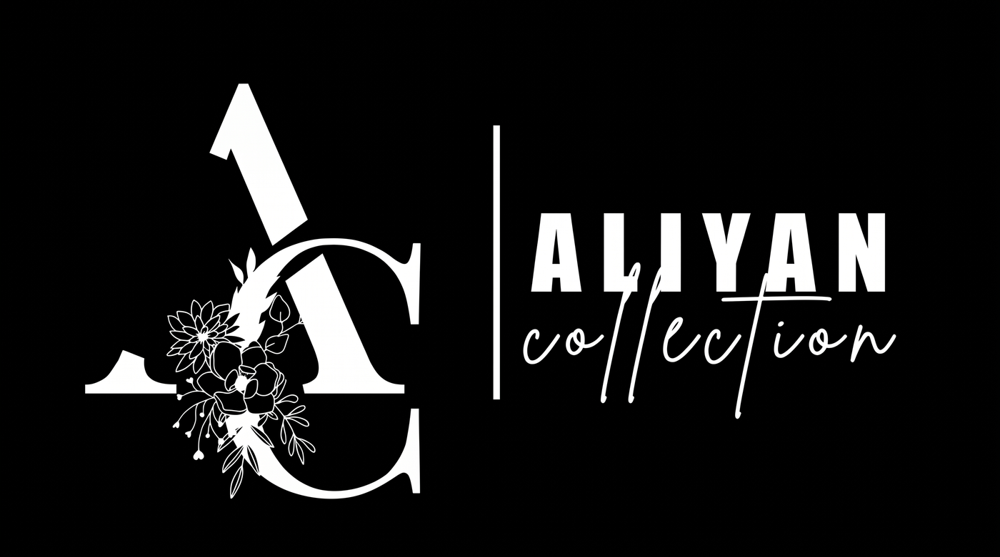
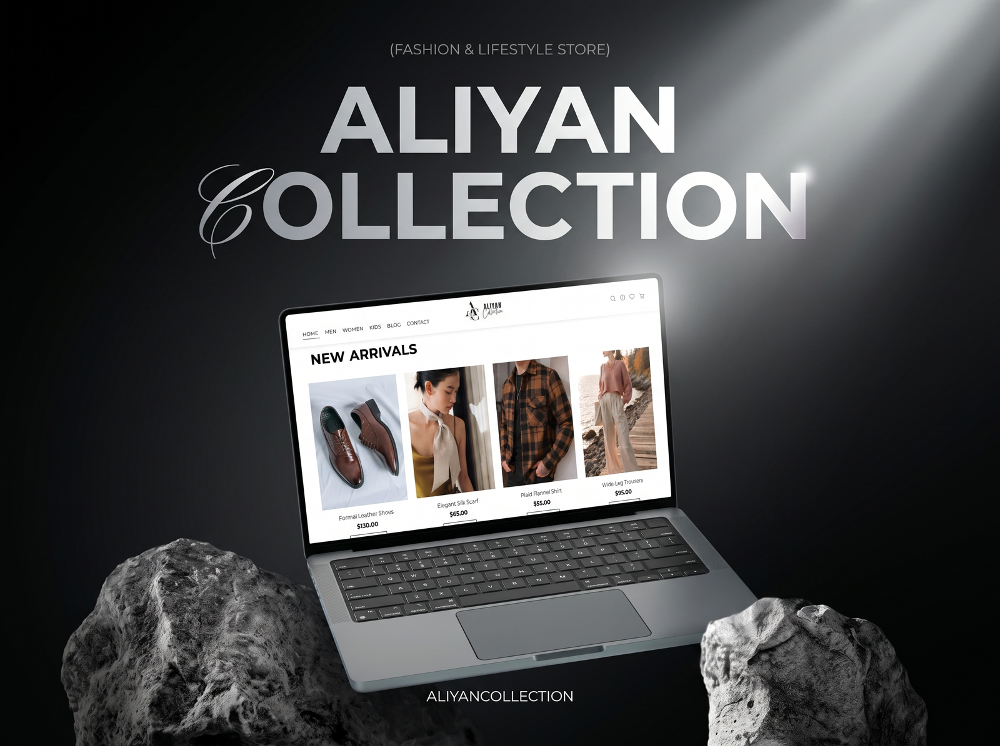
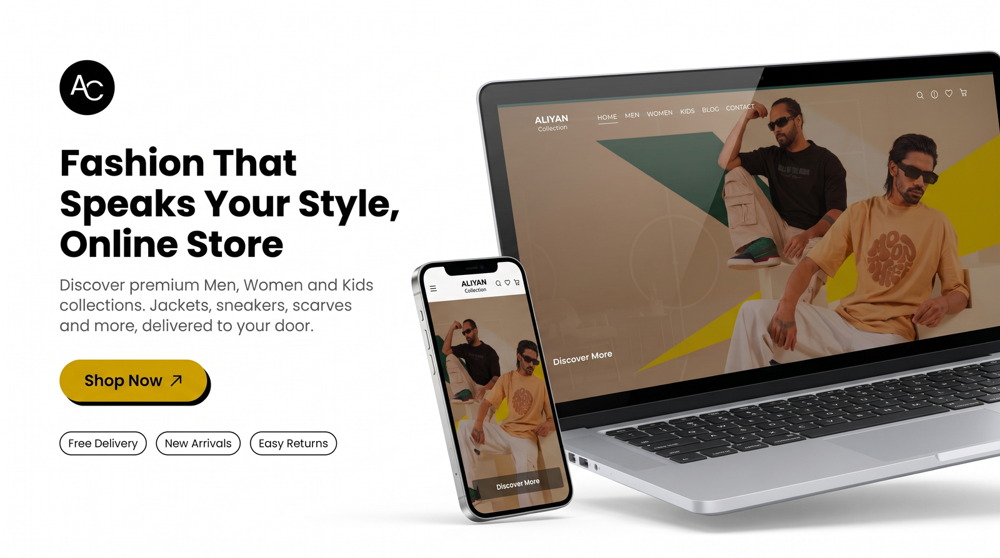
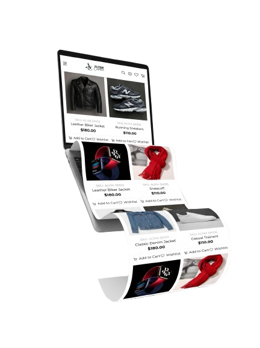
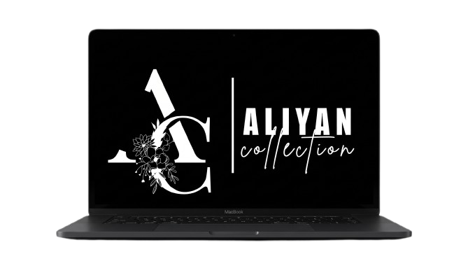
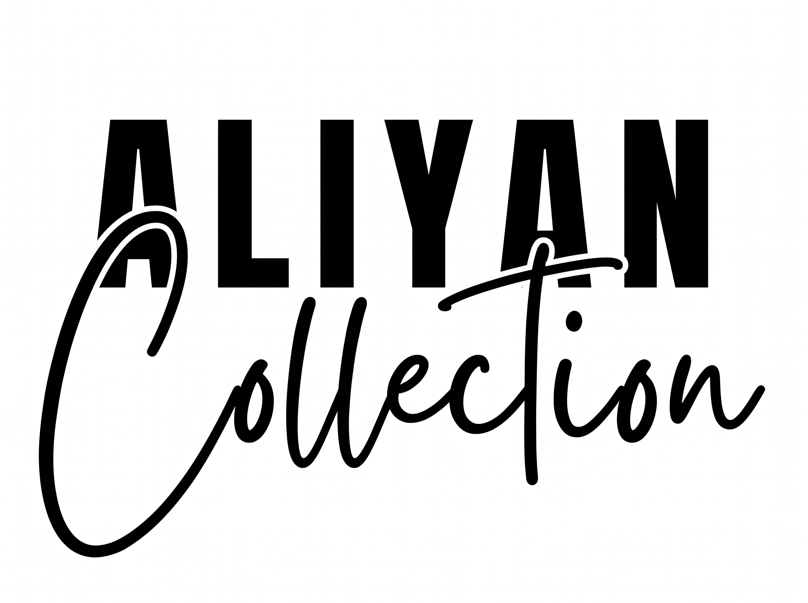

<div align="center">



<br>

### FASHION & LIFESTYLE E-COMMERCE STOREFRONT

**A premium, fully responsive, multi-page online store for Men, Women and Kids.**<br>
Pure HTML, CSS and Vanilla JavaScript. No frameworks. No backend. Deploy anywhere.

<br>

[](https://buildsbyaliyan.github.io/AliyanCollection-Ecommerce/)
[](https://github.com/BuildsByAliyan/AliyanCollection-Ecommerce)
[](LICENSE)


<br>

<a href="#overview">OVERVIEW</a> &nbsp;•&nbsp;
<a href="#preview">PREVIEW</a> &nbsp;•&nbsp;
<a href="#features">FEATURES</a> &nbsp;•&nbsp;
<a href="#pages">PAGES</a> &nbsp;•&nbsp;
<a href="#tech-stack">TECH STACK</a> &nbsp;•&nbsp;
<a href="#architecture">ARCHITECTURE</a> &nbsp;•&nbsp;
<a href="#getting-started">GETTING STARTED</a> &nbsp;•&nbsp;
<a href="#deployment">DEPLOYMENT</a> &nbsp;•&nbsp;
<a href="#contact">CONTACT</a>

<br><br>

<a href="https://buildsbyaliyan.github.io/AliyanCollection-Ecommerce/">
  
</a>

</div>

<br>

## OVERVIEW

**Aliyan Collection** is a complete frontend e-commerce solution for a modern clothing brand. It delivers a clean, minimalist and premium shopping experience across **Men's**, **Women's** and **Kids'** collections, from a cinematic intro screen to a persistent shopping cart.

Everything is written in **pure HTML, CSS and Vanilla JavaScript**. There is no framework, no package manager and no build step, so the project is easy to read, easy to customise and ready to host on any static server.

<table>
  <tr>
    <td width="33%" valign="top">
      <h4>SHOP WITH EASE</h4>
      Persistent cart and wishlist, instant product search, filtering and sorting, plus dedicated order and tracking pages.
    </td>
    <td width="33%" valign="top">
      <h4>CINEMATIC DESIGN</h4>
      Full-screen video intro, auto-playing hero slider, a transparent header that turns solid on scroll, and a smooth full-screen mobile menu.
    </td>
    <td width="33%" valign="top">
      <h4>CLEAN ARCHITECTURE</h4>
      Shared HTML partials, separated CSS layers, modular JavaScript and a single product catalogue file. Every piece of code lives in exactly one place.
    </td>
  </tr>
</table>

<br>

## PREVIEW

<div align="center">



</div>

<br>

<table>
  <tr>
    <td width="40%" align="center" valign="middle">
      
    </td>
    <td width="60%" valign="middle">
      <h3>PRODUCT SHOWCASE</h3>
      Clean product cards with price, sale pricing, <b>Add to Cart</b> and <b>Wishlist</b> actions on every item. Browse by department, filter, sort and open a full product detail page.
      <br><br>
      <b>Men</b> &nbsp;•&nbsp; <b>Women</b> &nbsp;•&nbsp; <b>Kids</b> &nbsp;•&nbsp; <b>Special Sale</b>
    </td>
  </tr>
</table>

<br>

### COLLECTIONS

<table>
  <tr>
    <td width="33%" align="center">
      <br>
      <b>MEN'S WEAR</b>
    </td>
    <td width="33%" align="center">
      <br>
      <b>WOMEN'S WEAR</b>
    </td>
    <td width="33%" align="center">
      <br>
      <b>SPECIAL SALE</b>
    </td>
  </tr>
</table>

<br>

## FEATURES

### SHOPPING EXPERIENCE

| Feature | Description |
|:--|:--|
| **Add to Cart** | One-click add to cart. The cart is saved in `localStorage` and survives page reloads and new sessions. |
| **Sliding Cart Panel** | Side-drawer cart with quantity controls and a real-time total. |
| **Wishlist** | Save favourite products. The wishlist is also persisted in `localStorage`. |
| **Product Search** | Instant search across the whole catalogue. |
| **Order Placement** | Dedicated order form for the checkout flow. |
| **Order Tracking** | Track an order from its own page. |

### PRODUCT CATEGORIES

| Category | Description |
|:--|:--|
| **Men's Wear** | Full collection page with filtering and sorting. |
| **Women's Wear** | Dedicated women's category. |
| **Kids' Wear** | Separate kids' section. |
| **Special Sales** | Highlighted promotional section on the homepage. |

### VISUAL AND UX DESIGN

| Feature | Description |
|:--|:--|
| **Cinematic Intro Screen** | Full-screen video splash with separate desktop and mobile versions. |
| **Hero Slider** | Auto-playing fade slider with arrows and pagination dots. |
| **Sticky Header** | Transparent navbar that turns solid on scroll, with the brand logo and wordmark. |
| **Full-Screen Mobile Menu** | Hamburger menu that opens as a full-screen navigation panel. |
| **Smooth Transitions** | CSS-powered animations and hover effects. |
| **Custom 404 Page** | Branded "page not found" screen that works on GitHub Pages and locally. |

### RESPONSIVE DESIGN

- Mobile-first layout with breakpoints for every screen size
- Separate images and videos for desktop and mobile
- Touch-friendly navigation and buttons

### TRUST, PAYMENT AND SOCIAL

- Accepted payment icons: **Visa**, **Mastercard**, **PayPal**, **Cash on Delivery**
- Newsletter subscription form and social proof sections
- Direct **WhatsApp** support link, plus **Facebook**, **Instagram** and **TikTok** links

<br>

## PAGES

| Page | Purpose |
|:--|:--|
| `index.html` | Homepage: hero, new arrivals, special sale, newsletter |
| `pages/shop/mens.html` | Men's product listing |
| `pages/shop/women.html` | Women's product listing |
| `pages/shop/kids.html` | Kids' product listing |
| `pages/shop/product.html` | Individual product detail page |
| `pages/info/about.html` | Brand story |
| `pages/info/blog.html` | Fashion blog |
| `pages/info/contact.html` | Contact form and details |
| `pages/account/myaccount.html` | User account page |
| `pages/account/wishlist.html` | Saved wishlist items |
| `pages/account/order.html` | Order placement |
| `pages/account/trackyourorder.html` | Order tracking |
| `pages/legal/return.html` | Return policy |
| `pages/legal/privacy.html` | Privacy policy |
| `404.html` | Custom "page not found" page |

<br>

## TECH STACK

| Technology | Usage |
|:--|:--|
| **HTML5** | Page structure and semantic markup |
| **CSS3** | Styling, animations, Flexbox, Grid and media queries |
| **Vanilla JavaScript** | Cart, wishlist, search, partial loading and DOM manipulation |
| **localStorage API** | Persistent cart and wishlist across sessions |
| **Google Fonts** | Montserrat font family |
| **MP4 Video** | Intro screen animation (desktop and mobile variants) |
| **GitHub Pages** | Hosting and deployment |

> **Zero dependencies.** No frameworks, no npm packages and no build step are required to run the website.

<br>

## ARCHITECTURE

The project is organised so that every piece of code lives in exactly one place.

| Layer | How it is organised |
|:--|:--|
| **Shared partials** | The header, cart panel, search and footer are written once in `docs/partials/` and loaded on every page. |
| **Separated CSS** | Base styles, reusable components and page styles each have their own files. |
| **Modular JavaScript** | Configuration, product data, core logic (cart, wishlist, storage), components and page scripts are separate modules. |
| **Single product catalogue** | All products are defined in `docs/js/data/products.js`, so a price or name is changed in one place. |
| **Professional asset naming** | Every image, icon and video is named by what it is, for example `men-slim-fit-denim-jeans.jpg`. |

<details>
<summary><b>CHANGING THE HEADER OR FOOTER</b></summary>

<br>

Edit `docs/partials/header.html` or `docs/partials/footer.html`, then run:

```bash
node tools/sync-fallback.js           # dry run
node tools/sync-fallback.js --write   # apply
```

This copies the partial into the built-in `FALLBACK_HTML` in `docs/js/components/header.js` and `footer.js`. That fallback is used when the partial cannot be fetched, for example when the site is opened with `file://`, so the two never drift apart.

</details>

<details>
<summary><b>FOLDER STRUCTURE</b></summary>

<br>

```
AliyanCollection-Ecommerce/
├── README.md
├── LICENSE
├── .gitignore
├── .nojekyll
│
├── .readme/                           # Images used by this README
├── tools/                             # Optional developer scripts (not used by the website)
│
└── docs/                              # Website root (GitHub Pages source)
    ├── index.html                     # Homepage
    ├── 404.html                       # Custom "page not found" page
    ├── robots.txt                     # Search engine rules
    ├── sitemap.xml                    # Sitemap for search engines
    ├── .nojekyll                      # Tells GitHub Pages not to use Jekyll
    │
    ├── pages/
    │   ├── shop/                      # mens, women, kids, product
    │   ├── account/                   # myaccount, wishlist, order, trackyourorder
    │   ├── info/                      # about, blog, contact
    │   └── legal/                     # privacy, return
    │
    ├── partials/                      # Shared HTML loaded on every page
    │   ├── header.html                # Cart panel, search, mobile menu, navbar
    │   └── footer.html                # Site footer
    │
    ├── css/
    │   ├── base/                      # variables, reset, typography
    │   ├── components/                # header, footer, cart-panel, product-card, buttons, toast
    │   └── pages/                     # home, shop, product, about, blog, contact, account, order, legal
    │
    ├── js/
    │   ├── config.js                  # Site-wide settings (storage keys, contact details)
    │   ├── data/
    │   │   └── products.js            # The single product catalogue
    │   ├── core/                      # storage, cart, wishlist, utils
    │   ├── components/                # header, footer, cart-panel, product-card, toast
    │   └── pages/                     # home, shop, product, order, track-order, account
    │
    └── assets/
        ├── images/
        │   ├── products/              # men/, women/, kids/
        │   ├── banners/               # hero slides, category and promo banners
        │   ├── blog/                  # blog cover images
        │   └── brand/                 # logos and favicon
        ├── icons/
        │   ├── social/                # Facebook, Instagram, TikTok, WhatsApp, Pinterest
        │   ├── payment/               # Visa, Mastercard, PayPal, Cash on Delivery
        │   └── ui/                    # cart, search, wishlist and feature icons
        └── videos/
            ├── desktop/               # Intro and page videos (desktop)
            └── mobile/                # Intro and page videos (mobile)
```

</details>

<br>

## BRAND IDENTITY

<div align="center">



<br>

<table>
  <tr>
    <td align="center" width="25%"><br><sub>FLORAL MARK</sub></td>
    <td align="center" width="25%"><br><sub>WORDMARK</sub></td>
    <td align="center" width="25%"><br><sub>MONOGRAM DARK</sub></td>
    <td align="center" width="25%"><br><sub>MONOGRAM LIGHT</sub></td>
  </tr>
</table>

</div>

<br>

## GETTING STARTED

### 1. CLONE THE REPOSITORY

```bash
git clone https://github.com/BuildsByAliyan/AliyanCollection-Ecommerce.git
cd AliyanCollection-Ecommerce
```

### 2. RUN A LOCAL SERVER

> [!IMPORTANT]
> The header and footer are loaded from `partials/` using `fetch()`, which browsers block when a page is opened by double-clicking it (`file://`). Use any of the local servers below for the full experience.

**OPTION A: VS CODE LIVE SERVER (RECOMMENDED)**

1. Install the **Live Server** extension in VS Code
2. Right-click `docs/index.html`
3. Choose **Open with Live Server**

**OPTION B: PYTHON**

```bash
cd docs
python -m http.server 8000
# open http://localhost:8000
```

**OPTION C: NODE**

```bash
cd docs
npx serve
```

<br>

## CUSTOMISATION

| I want to change... | Edit this file |
|:--|:--|
| Products, prices and names | `docs/js/data/products.js` |
| Storage keys and contact details | `docs/js/config.js` |
| Header, cart panel, search or mobile menu | `docs/partials/header.html` |
| Footer | `docs/partials/footer.html` |
| Colours, spacing and fonts | `docs/css/base/variables.css` |
| Navbar and mobile menu styling | `docs/css/components/header.css` |

<br>

## DEPLOYMENT

Deploy the site for free on **GitHub Pages**:

1. Push the repository to GitHub
2. Open **Settings → Pages**
3. Under **Source**, choose **Deploy from a branch**
4. Select the `main` branch and the `/docs` folder, then click **Save**

Your store will be live at:

**[buildsbyaliyan.github.io/AliyanCollection-Ecommerce](https://buildsbyaliyan.github.io/AliyanCollection-Ecommerce/)**

<br>

## CONTACT

| Platform | Link |
|:--|:--|
| **Website** | [buildsbyaliyan.github.io/AliyanCollection-Ecommerce](https://buildsbyaliyan.github.io/AliyanCollection-Ecommerce/) |
| **WhatsApp** | [+92 370 0256087](https://wa.me/923700256087) |
| **Facebook** | [creativestudi0.pk_](https://facebook.com/creativestudi0.pk_) |
| **Instagram** | [@creativestudi0.pk_](https://instagram.com/creativestudi0.pk_) |
| **TikTok** | [@creativestudi0.pk_](https://www.tiktok.com/@creativestudi0.pk_) |

<br>

## LICENSE

This project is licensed under the **MIT License**. See the [LICENSE](LICENSE) file for details.

<br>

<div align="center">

**DESIGNED AND DEVELOPED BY [ALIYAN](https://github.com/BuildsByAliyan)**

If you like this project, please consider giving it a ⭐ on GitHub.

<sub>© 2026 Aliyan Collection · Released under the MIT License</sub>

</div>
